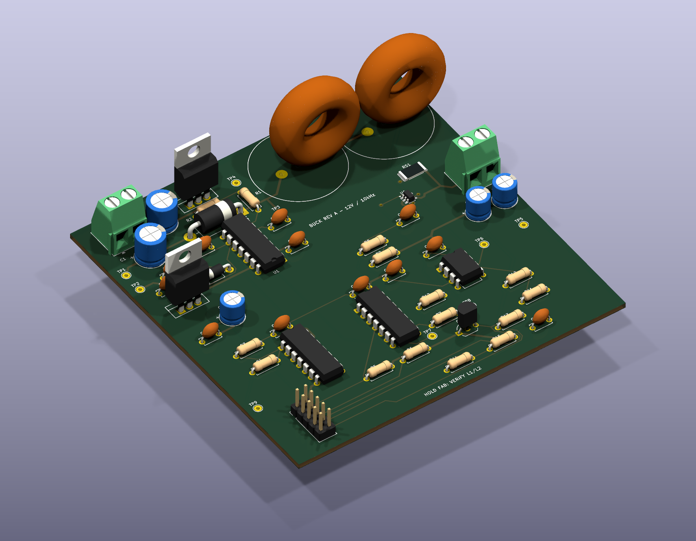

# Validación experimental del Buck en lazo abierto

Entrega 2: Metodología; mediciones pendientes

Martín Ramírez Espinosa — maramirezes@unal.edu.co

Jerónimo Vargas Orozco — jevargaso@unal.edu.co

Andrew Esteban Henao Becerra — anhenaobe@unal.edu.co

Mateo Alexander Cardenas Cuesta — macardenascu@unal.edu.co

Universidad Nacional de Colombia, Sede Manizales

## Resumen

Se especifican la identificación de componentes, los dos ensayos de lazo abierto y las métricas de error. Se formula el modelo ajustado y se preparan tablas de registro. No hay datos de laboratorio: los resultados experimentales permanecen pendientes.

## Objetivo y estado experimental

La guía exige medir $R$, $L$ y $C$ y contrastar ambos escalones con el modelo ajustado [1]. No se han recibido mediciones ni capturas físicas: el documento establece el protocolo y los registros pendientes.

*Parámetros de la guía*

| Magnitud | Valor |

| --- | --- |

| $V_{\mathrm{in}}$ | $12\,\mathrm{V}$ |

| $L$; $C$ | $660\,\mu\mathrm{H}$; $20\,\mu\mathrm{F}$ |

| $R$; $f_s$ | $6\,\Omega$; $10\,\mathrm{kHz}$ |

| $D'=0.5$ | $V_o=6\,\mathrm{V}$; $I_L=1\,\mathrm{A}$ |

Se seleccionan dos resistencias de $12\,\Omega$, $10\,\mathrm{W}$ en paralelo: carga nominal de $6\,\Omega$, $20\,\mathrm{W}$: el nominal disipa $6\,\mathrm{W}$ y a $7.2\,\mathrm{V}$ disipa $8.64\,\mathrm{W}$. Registrar temperatura y resistencia efectiva. Verificar terminales y referencias de los componentes reales.

## Diseño preparado para construcción

La placa de $99\times99\,\mathrm{mm}$, dos capas y 57 componentes dispone de archivos KiCad, lista de materiales y salidas de fabricación para revisión. ERC, DRC y correspondencia esquema--placa no registran infracciones. Esto verifica reglas CAD, no funcionamiento eléctrico. No se han comprado componentes ni construido el prototipo.

*Figura (pcb-power): Conectividad resumida de potencia, driver y sensor de la placa IR2110. El esquema completo con todos los pines está en el anexo de hardware.*

*Figura (pcb-3d): Vista CAD isométrica; no es una fotografía. Inductores: envolvente provisional. Capacitores: geometría genérica del encapsulado, referencia comercial pendiente.*

*Figura (pcb-layout): Vista de componentes con referencias y conectores. Las conexiones externas se detallan en el anexo.*

La fabricación permanece retenida hasta confirmar dimensiones, saturación y DCR de L1/L2, referencia y corriente de rizado de C4/C5, y verificar bootstrap, apagado y sensores en prototipo soldado. El STM32, programador y banco de carga se conectan externamente. El objetivo de presupuesto es COP 350\,000; el estimado de COP 281\,501.95 incluye asignaciones sin cotización final, dejando COP 68\,498.05 de reserva.

## Identificación de parámetros

*Registro con medidor de parámetros; P = pendiente*

| Dato | Nominal | Medido | Incert. |

| --- | --- | --- | --- |

| $V_{\mathrm{in}}$ (V) | 12 | P | P |

| $R$ ($\Omega$) | 6 | P | P |

| $L$ ($\mu$H) | 660 | P | P |

| $C$ ($\mu$F) | 20 | P | P |

| $r_L$ ($\Omega$) | 0.20 (sup. PCB) | P | P |

| $r_C$ ($\Omega$) | 0.15 (sup. PCB) | P | P |

| PWM (kHz) | 10 | P | P |

Registrar instrumento, identificación, calibración, frecuencia de prueba, resolución, fecha y temperatura. Medir sin energizar; comprobar ausencia de saturación del inductor bajo corriente. Conservar fotografías y datos originales.

## Modelo con parámetros medidos

El subíndice $m$ denota parámetros medidos. La comparación principal actualiza la planta ideal:

$$
G_{d^{\prime},m}(s)=\frac{-V_{\mathrm{in},m}}{L_mC_ms^2+(L_m/R_m)s+1}.
$$

Como contraste adicional, incluir DCR y omitir ESR conduce a:

$$
\begin{aligned}G_{d^{\prime},r_L}(s)&=\frac{-V_{\mathrm{in},m}}{D_m(s)},\\D_m(s)&=L_mC_ms^2+(L_m/R_m+r_LC_m)s\\&\quad+1+r_L/R_m.\end{aligned}
$$

Este segundo modelo no incorpora caídas de diodos ni driver. El analizador disponible resuelve el modelo ideal con parámetros medidos y duty registrado; no identifica automáticamente pérdidas. Inicializar con tensión y corriente previas medidas. Si falta corriente, declarar $i_L(t_i)=v_o(t_i)/R_m$ como hipótesis.

## Procedimiento de adquisición

Comprobar continuidad, polaridad, PWM y apagado sin potencia. Verificar que aumentar $d^{\prime}$ reduce el tiempo ON. Energizar con fuente limitada y observar corriente y $v_{GS}$. En nodos flotantes usar medida diferencial apropiada; no conectar allí la masa de una sonda referida a tierra.

Estabilizar con $d^{\prime}=0.5$. Aplicar por separado $0.5\to0.6$ y $0.5\to0.4$, regresando al nominal entre capturas. Registrar duty y tensión simultáneamente al menos $5\,\mathrm{ms}$ antes y $20\,\mathrm{ms}$ después. Realizar tres repeticiones de cada caso.

Para rizado adquirir al menos $200\,\mathrm{kS/s}$; documentar ancho de banda y desfase de canales. Promediar periodos completos sincronizados al PWM y conservar la forma instantánea.

## Análisis y tablas de resultados

Se compara la media por periodo $\bar v_c[k]$ con el modelo $v_m[k]$ interpolado en el centro de cada periodo. Para $N$ muestras:

$$
\begin{aligned}e_k&=\bar v_c[k]-v_m[k],\\E_{\mathrm{RMS}}&=\sqrt{\frac1N\sum_{k=1}^N e_k^2},\quad E_{\max}=\max_k|e_k|.\end{aligned}
$$

El error incremental resta a cada curva su propia media previa al evento, $v_{c,0}$ o $v_{m,0}$:

$$
e_{\Delta,k}=(\bar v_c[k]-v_{c,0})-(v_m[k]-v_{m,0}).
$$

$E_{\mathrm{RMS},\Delta}$ usa la misma raíz cuadrática con $e_{\Delta,k}$. El error normalizado es $100E_{\mathrm{RMS}}/|\Delta V_{\mathrm{ideal}}|$, donde el cambio nominal tiene magnitud $1.2\,\mathrm{V}$.

*Resultados experimentales: $d^{\prime}$ $0.5\to0.6$*

| Magnitud | Modelo medido | Experimento |

| --- | --- | --- |

| $v_{o,0}$; $v_{o,\infty}$ (V) | Pendiente | Pendiente |

| $M_p$ (\%); $t_s$ (ms) | Pendiente | Pendiente |

| $E_{\mathrm{RMS}}$; $E_{\max}$ (V) | --- | Pendiente |

| $E_{\mathrm{RMS},\Delta}$ (V) | --- | Pendiente |

| Rizado (V) | No incluido | Pendiente |

*Resultados experimentales: $d^{\prime}$ $0.5\to0.4$*

| Magnitud | Modelo medido | Experimento |

| --- | --- | --- |

| $v_{o,0}$; $v_{o,\infty}$ (V) | Pendiente | Pendiente |

| $M_p$ (\%); $t_s$ (ms) | Pendiente | Pendiente |

| $E_{\mathrm{RMS}}$; $E_{\max}$ (V) | --- | Pendiente |

| $E_{\mathrm{RMS},\Delta}$ (V) | --- | Pendiente |

| Rizado (V) | No incluido | Pendiente |

Reportar media y dispersión de las tres repeticiones, ventanas y banda del 2\% respecto del cambio final de cada curva. La comparación absoluta evalúa exactitud; la incremental separa sesgo y dinámica. No afirmar cumplimiento de una banda menor que la incertidumbre instrumental.

## Discusión y criterio de cierre

Superponer modelo nominal, modelo medido y experimento. Explicar tolerancias, pérdidas y errores instrumentales con evidencia. El cierre requiere ambas respuestas, parámetros medidos, incertidumbre, fotografías y conclusiones basadas en capturas. La validación física permanece pendiente.

## Apéndice: Archivos de análisis

El CSV contiene `time_s`, `voltage_V`, `dprime`, `load_ohm` y `reference_V`. El JSON contiene `Vin`, `L_H`, `C_F`, `R_ohm`, `step_time_s`, instrumento y fecha; `initial_current_A` es opcional. Ejecutar `analyze_experiment.py` según `project/data/README.md`. Conservar calibración y archivos originales de cada repetición.

## Referencias

[1] J. D. Bastidas Rodríguez, ``Proyecto de Curso: Convertidor Buck con control de tensión de salida, Universidad Nacional de Colombia, mayo 2025, pp. 1--3.
